# Guía de uso — Turnos médicos

Esta guía explica cómo preparar y publicar cada mes el calendario de turnos de
mañana y tarde del equipo. Está pensada para la persona que organiza los
turnos (el **planificador**); no hace falta ningún conocimiento técnico.

## Índice

1. [Qué hace la aplicación](#1-qué-hace-la-aplicación)
2. [Abrir la aplicación](#2-abrir-la-aplicación)
3. [Cómo está organizada](#3-cómo-está-organizada)
4. [Primera configuración](#4-primera-configuración)
5. [Cada mes: generar, revisar y publicar](#5-cada-mes-generar-revisar-y-publicar)
6. [Retocar el calendario a mano](#6-retocar-el-calendario-a-mano)
7. [Compartir el calendario](#7-compartir-el-calendario)
8. [Copias de seguridad](#8-copias-de-seguridad)
9. [Preguntas frecuentes](#9-preguntas-frecuentes)

---

## 1. Qué hace la aplicación

- Reparte automáticamente los turnos de **mañana** y **tarde** de lunes a
  viernes, sin contar festivos.
- Respeta las reglas de cada médico: qué turnos puede hacer, cuáles hace
  siempre, cuántos turnos tiene que hacer al mes y sus ausencias.
- Cubre cada turno con el número de médicos que indiques.
- Reparte la carga de forma equilibrada y tiene en cuenta los meses
  anteriores, para que las diferencias se compensen con el tiempo.
- Te deja retocar el resultado a mano y te avisa al momento si algún cambio
  incumple una regla.

Algunas palabras que aparecen en la aplicación:

| Palabra | Significado |
|---|---|
| **Turno** | Una mañana o una tarde de un día concreto. |
| **Medio turno (½)** | La mitad de un turno. Se usa en las jornadas de *turno y medio*: mañana + primera mitad de la tarde, o segunda mitad de la mañana + tarde. |
| **Cobertura** | Cuántos médicos necesita cada turno (mínimo y máximo). |
| **Carga** | Cuántos turnos tiene que hacer un médico en el mes (mínimo y máximo). |
| **Bloqueado (BLOQ.)** | Un turno cambiado a mano: el generador lo respeta al volver a generar. |
| **Publicado** | Mes cerrado: ya no se puede modificar salvo que se reabra. |

## 2. Abrir la aplicación

La aplicación funciona en tu ordenador y no necesita internet. Los cambios se
guardan solos al momento; no hay botón de «guardar todo».

### Desde el menú de aplicaciones (lo habitual)

Busca **Turnos médicos** en las aplicaciones de GNOME (tecla Super y escribe
«turnos») y ábrela. Se abre en su propia ventana.

- Para cerrarla, cierra la ventana (o **Ctrl+Q**). Lo último que hayas
  cambiado se guarda antes de cerrar.
- Si ya está abierta, volver a abrirla te lleva a la misma ventana.
- El menú **☰** de la barra de título tiene *Recargar*, *Imprimir*, el zoom
  (también con **Ctrl +** y **Ctrl −**) y *Acerca de*.
- Al exportar o descargar una copia, la aplicación pregunta dónde guardar el
  fichero y avisa al terminar, con un botón para abrirlo.

Cada usuario del ordenador tiene sus propios datos: lo que hagas no lo ve
quien entre con otra cuenta.

### Desde el navegador

Si quien mantiene la aplicación no la ha instalado en el menú, o prefieres el
navegador:

1. Abre una terminal en la carpeta del proyecto.
2. Escribe `.venv/bin/turnos` y pulsa Intro.
3. Se abrirá el navegador con la aplicación. Si no se abre, copia la dirección
   que aparece en la terminal (empieza por `http://127.0.0.1:8000/?token=`).

Para cerrarla, vuelve a la terminal y pulsa **Ctrl+C**. Las dos formas usan
los mismos datos.

> Solo tú puedes acceder a la aplicación: no es visible desde otros
> ordenadores de la red, ni desde otras cuentas del mismo ordenador.

## 3. Cómo está organizada

Arriba hay siempre una cabecera con:

- El **mes de trabajo** y sus flechas ‹ ›. Por defecto es el mes siguiente,
  que es el que normalmente se planifica. Todas las pestañas trabajan sobre
  ese mes.
- Las **pestañas**: *Calendario*, *Médicos y reglas*, *Cobertura*,
  *Festivos* y *Configuración*. Junto a *Calendario* aparece en rojo el
  número de reglas que no se cumplen, si hay alguna.

## 4. Primera configuración

La pestaña **Calendario** muestra, en el panel **Problemas a resolver**, lo
que falta por configurar antes de generar: la cobertura sin definir, médicos
sin carga mensual o festivos pendientes de publicar.

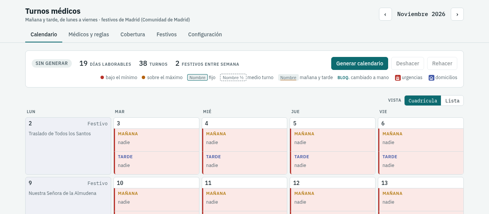

### 4.1 Médicos y reglas

Cada médico tiene una tarjeta. Pulsa **Añadir médico** al final de la página
para crear una nueva y escribe su nombre y un **código** corto (las
iniciales). Todo se guarda solo: los datos al salir del campo, y las reglas
medio segundo después de cada cambio. Debajo de cada tarjeta verás «Guardado».
Puedes cambiar de pestaña en cuanto acabes: lo que quede por guardar se envía
al salir.

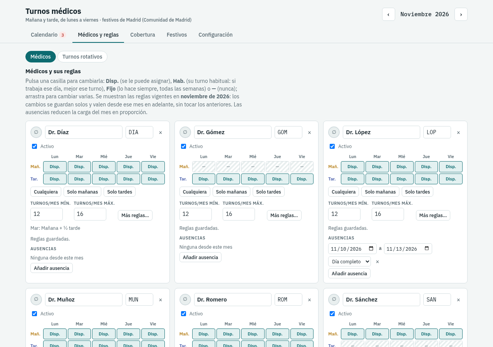

En cada tarjeta:

- **Color**: el círculo junto al nombre abre una paleta para elegir el color
  del médico (o *Otro* para uno a medida, o *Sin color*). Su nombre aparecerá
  con ese color de fondo en el calendario, para ver de un vistazo quién hace
  cada turno. El campo del nombre se tiñe del color elegido. Los médicos
  nuevos reciben un color libre de la paleta.

  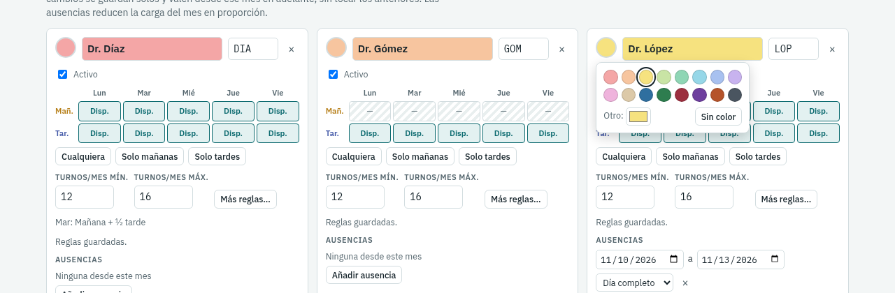
- **Cuadrícula de turnos**: una fila para las mañanas (*Mañ.*) y otra para
  las tardes (*Tar.*), de lunes a viernes. Cada casilla puede ser:
  - **Disp.** (disponible): el generador puede ponerle ese turno.
  - **Hab.** (habitual): su turno de ese día. No le obliga a trabajar ese
    día, pero si trabaja, el generador le pone preferentemente ese turno. Es
    lo que conviene marcar para indicar «los lunes, de mañana».
  - **Fijo**: lo hace **siempre**, todas las semanas (salvo ausencia o
    festivo), aunque no haga falta. Úsalo solo para turnos realmente
    obligatorios: si marcas un Fijo cada día, el médico trabajará todos los
    días.
  - **—**: nunca se le pone ese turno.

  Haz clic en una casilla para cambiarla (Disp. → Hab. → Fijo → —), o mantén pulsado y arrastra para
  cambiar varias de golpe. *Cualquiera*, *Solo mañanas* y *Solo tardes*
  rellenan la cuadrícula entera.
- **Turnos/mes mín. y máx.**: la carga mensual. Se admiten medios turnos
  (por ejemplo, `12,5`). Mientras falte, el resto de reglas se guarda igual,
  pero el médico no recibe turnos: la tarjeta lo avisa.
- **Más reglas…** abre un panel lateral con las reglas menos habituales:
  - **Jornadas de más de un turno**: si un médico hace un día fijo de la
    semana *mañana + ½ tarde*, *½ mañana + tarde* o *mañana y tarde*. El
    generador **nunca** crea estas jornadas por su cuenta.
  - **Límites por tipo de turno**: por ejemplo, «entre 4 y 6 tardes al mes».
    Deja el máximo vacío si no hay límite.
  - **Preferencias**: turnos que el médico prefiere o que prefiere evitar. Se
    respetan siempre que no impidan cumplir las demás reglas.

  Debajo de la carga aparece un resumen de estas reglas.

  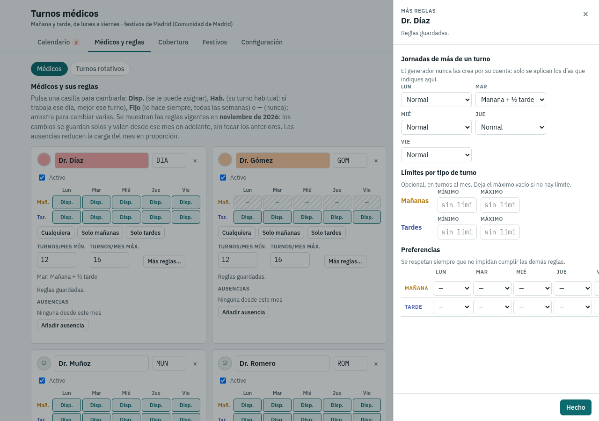
- **Ausencias**: pulsa **Añadir ausencia** y ajusta las fechas y si es el día
  completo o solo las mañanas o las tardes. Se ven las ausencias desde el mes
  de trabajo en adelante. Solo se guardan las fechas, nunca el motivo.
- **Activo**: si un médico deja el equipo, desmarca la casilla en lugar de
  borrarlo (×), para que sus turnos de meses pasados se conserven.

Las reglas que ves son las **vigentes en el mes de trabajo**, y los cambios
valen **desde ese mes en adelante**: los meses anteriores no cambian. Para
cambiar las reglas a partir de enero, elige enero con las flechas de la
cabecera antes de editar.

Las ausencias reducen automáticamente la carga del médico en proporción a los
días que falta. Por ejemplo, un médico con 16–18 turnos que está de
vacaciones 5 de 20 días laborables pasa a tener 12–13,5 ese mes.

### 4.2 Turnos rotativos

En **Médicos y reglas → Turnos rotativos** se definen grupos de médicos que
comparten unos turnos de la semana **sin coincidir**: cada semana los hace
uno de ellos, como turno fijo, por orden.

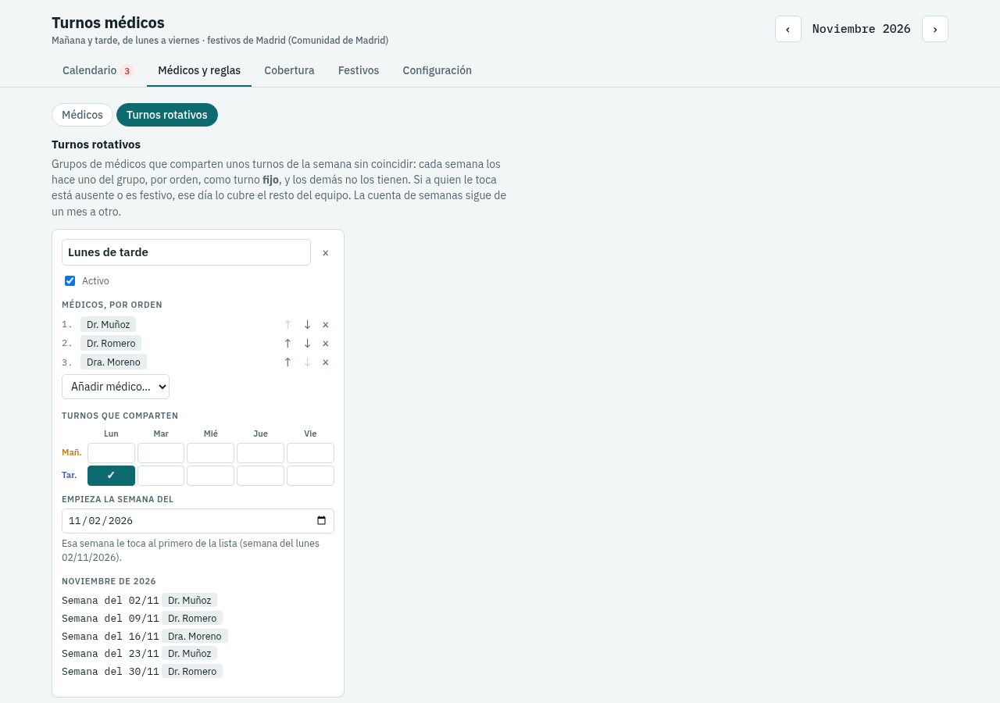

1. Pulsa **Añadir turno rotativo** y ponle un nombre.
2. **Médicos, por orden**: añádelos con el desplegable y ordénalos con las
   flechas. La semana de inicio le toca al primero, la siguiente al segundo,
   y así sucesivamente.
3. **Turnos que comparten**: marca en la cuadrícula los turnos de la semana
   (por ejemplo, lunes y jueves por la tarde).
4. **Empieza la semana del**: la semana en que le toca al primero. Por
   defecto, la primera semana del mes de trabajo.
5. Abajo se ve a quién le toca cada semana del mes de trabajo.

La semana que no le toca, un médico del grupo no recibe esos turnos (aunque
los tenga como *Fijo* en su tarjeta). Si a quien le toca está ausente o es
festivo, ese día lo cubre el resto del equipo. La cuenta de semanas sigue de
un mes a otro. Se guarda solo; con la casilla *Activo* se desactiva sin
borrarlo.

### 4.3 Cobertura

En **Cobertura** indica cuántos médicos necesita cada turno, con un mínimo y
un máximo, para cada día de la semana. Se guarda sola.

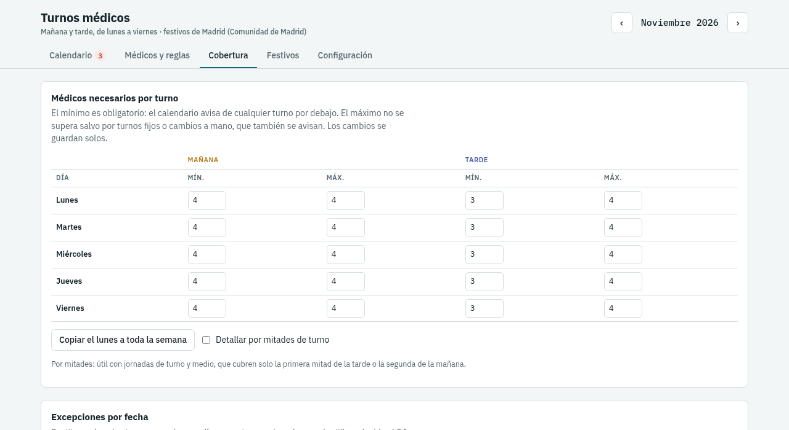

- **Copiar el lunes a toda la semana** ahorra repetir los mismos números.
- **Detallar por mitades de turno**: solo hace falta si hay médicos con
  jornada de turno y medio. Por ejemplo, si un médico hace *mañana + ½ tarde*
  y la tarde necesita 3 médicos, conviene permitir 4 en la primera mitad de
  la tarde.
- **Excepciones por fecha**: para días concretos con otra plantilla (por
  ejemplo, el 24 de diciembre).

### 4.4 Festivos

La aplicación viene con los festivos de **Madrid** (nacionales, de la
Comunidad de Madrid y locales). Si el centro está en otro municipio, cámbialo
en **Configuración → Festivos oficiales** y busca allí sus festivos (ver 4.5).
En **Festivos** ves los del año del mes de trabajo y puedes:

- Cambiar de año con los botones ‹ y ›.
- Añadir o quitar festivos.
- **Restaurar los precargados** si quitaste alguno por error (solo Madrid).

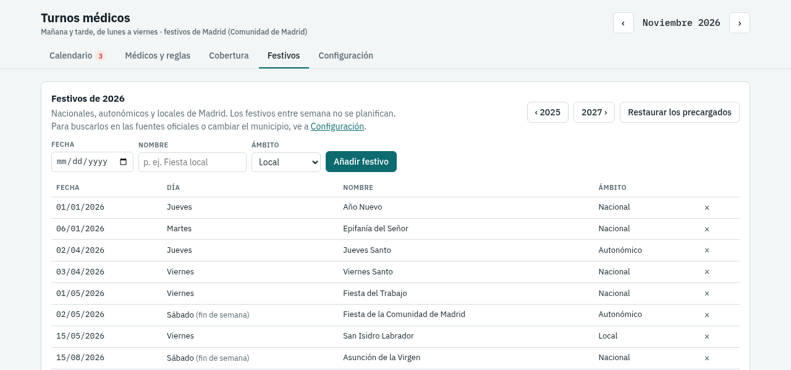

Si un año está incompleto (por ejemplo, porque el Ayuntamiento aún no ha
publicado sus dos fiestas locales), verás un aviso. Búscalas en
*Configuración → Festivos oficiales* en cuanto se publiquen (normalmente a
final de año), o añádelas a mano.

### 4.5 Configuración

**Cuánto trabaja cada médico.** Hay dos formas:

- **Según un rango de turnos al mes en su ficha** (la de siempre): cada médico
  recibe entre el mínimo y el máximo de su tarjeta, reducidos por sus ausencias.
- **Todos los días laborables, salvo ausencia**: cada médico tiene al menos un
  turno cada día que no está ausente, y los turnos que sobran se reparten por
  igual, en proporción a los días que está. No hacen falta rangos: las tarjetas
  de los médicos no los piden (tampoco los límites por tipo de turno de «Más
  reglas») y la tabla de carga del calendario y la hoja de cálculo no los
  muestran. Lleva incluida la opción siguiente.

**Reglas generales.** La opción **Todos los médicos trabajan cada día
laborable** (activada por defecto) hace que cada médico tenga al menos un
turno cada día, salvo los días que está ausente o en que no tiene ningún turno
posible (los dos marcados «—» en su tarjeta). Si solo falta por la mañana,
trabaja por la tarde, y al revés. Para que encaje, la cobertura máxima de
mañana y tarde y la carga mensual de cada médico tienen que dar cabida a todos;
si no, el calendario avisa de qué límite subir. Desactivada, cada médico
trabaja solo los días necesarios para cubrir los turnos y su carga.

La opción **Urgencias y domicilios según la presencia de cada médico en el
mes** (activada por defecto) reparte esos papeles en proporción a las tardes
en que cada médico está (las ausencias reducen su parte). Desactivada, se
reparten por igual entre todos, siempre que tengan tardes suficientes. Se
aplica al generar o regenerar.

A veces no se pueden igualar las dos cosas: por ejemplo, si un médico solo
puede trabajar unas pocas tardes, no le dan para su parte de urgencias y de
domicilios a la vez. **Si no se pueden repartir las dos cosas por igual** dice
cuál se mantiene igual para todos: por defecto, **las urgencias** (la
diferencia va a los domicilios); también puede ser al revés o sin preferencia.

**Vista del calendario.** La opción **Mostrar en cada turno los médicos
asignados frente a los necesarios** (desactivada por defecto) añade a cada
mañana y tarde del calendario una cifra como «6/0–7»: 6 médicos asignados para
un mínimo de 0 y un máximo de 7. Aunque esté desactivada, los turnos por
debajo del mínimo o por encima del máximo se resaltan igual.

Además, en **Configuración** puedes cambiar el horario de los turnos (por defecto,
mañana de 08:00 a 15:00 y tarde de 15:00 a 22:00) y el **corte** que separa
las dos mitades de cada turno. El horario aparece en el calendario impreso y
en la hoja de cálculo.

**Festivos oficiales.** Indica el **municipio del centro** (botón
*Cambiar*, escribe parte del nombre y elígelo de la lista). Después elige el
año y pulsa **Buscar festivos oficiales**: la aplicación consulta en internet
los festivos nacionales, autonómicos y locales de ese municipio y los muestra
con su fuente (por ejemplo, la referencia del BOE, que se puede abrir). La
última columna dice si ya los tienes:

- **Falta**: no está en tus festivos. **Añadir los N que faltan** los añade.
- **Ya está**: lo tienes igual.
- **Distinto**: ya tienes un festivo ese día con otro nombre o ámbito (por
  ejemplo «Fiesta local» en lugar de «San Isidro»). No se cambia.

Nunca se borra ni se cambia ningún festivo tuyo; si las fuentes no tienen
alguno que tú sí, se indica debajo por si sobra. Si los festivos locales del
año aún no se han publicado, se avisa: vuelve a buscar más adelante. Hace
falta conexión a internet.

**Datos: exportar e importar.** Ver la sección 8.

## 5. Cada mes: generar, revisar y publicar

Abre **Calendario** con el mes que quieras planificar.

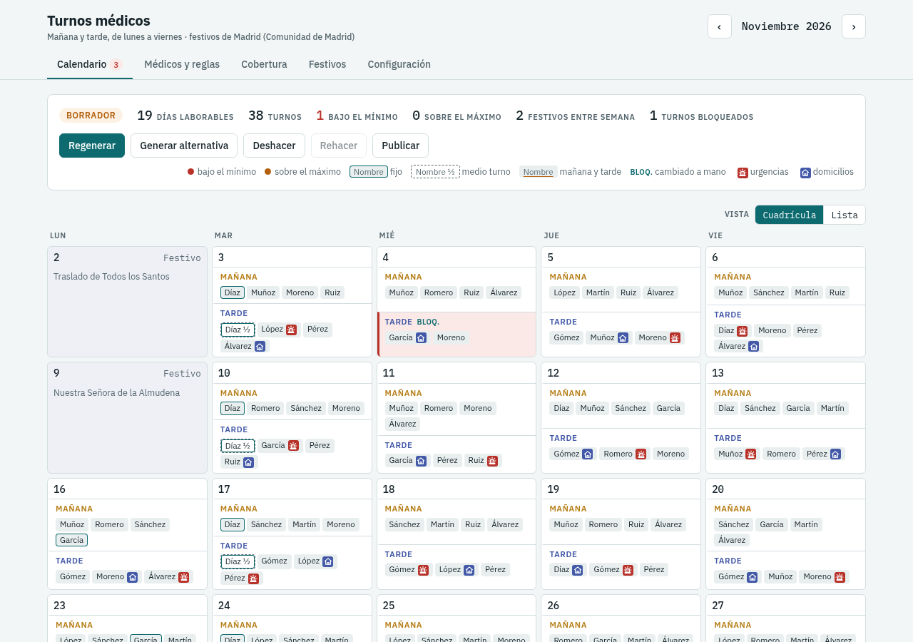

1. Revisa antes las **ausencias** del mes en las tarjetas de los médicos.
2. Pulsa **Generar calendario**. En unos segundos se rellena todo el mes.
3. Revisa el resultado:
   - El panel de arriba resume el mes: días laborables, turnos, cuántos están
     **bajo el mínimo** o **sobre el máximo**, festivos y turnos bloqueados.
   - Cada día es una tarjeta con su **MAÑANA** y su **TARDE**. La cifra de la
     derecha dice «asignados / mínimo–máximo». Un turno al que le falta gente
     se ve en **rojo**, y uno con gente de más lleva una franja **ámbar**.
   - Cada nombre lleva el color de su médico. Los nombres con borde son
     médicos **fijos**; con borde discontinuo y
     «½», **medio turno**; subrayados, médicos que ese día hacen **mañana y
     tarde**.
   - Debajo, **Problemas a resolver** lista las reglas que no se cumplen, con
     su causa cuando se conoce; pulsa una para ir a ese día. **Carga por
     médico** muestra los turnos de cada uno frente a su rango del mes (en
     rojo si se sale), sus días de turno y medio y sus días dobles.

   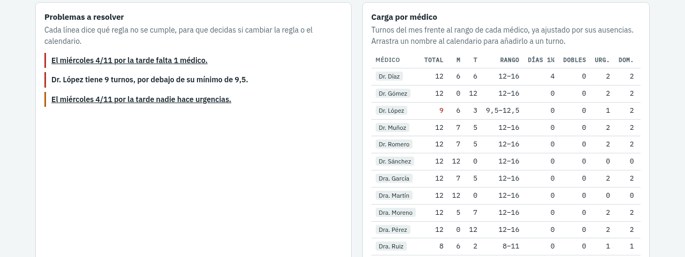

   Encima del calendario, el selector **Vista** cambia entre **Cuadrícula**
   (el mes por semanas, como en un calendario de pared) y **Lista** (un día
   por fila, uno tras otro, con la mañana y la tarde lado a lado; los lunes
   empiezan un bloque nuevo). Las dos vistas funcionan igual: se pulsa un
   turno para editarlo y se puede arrastrar. La aplicación recuerda la vista
   que elijas.

   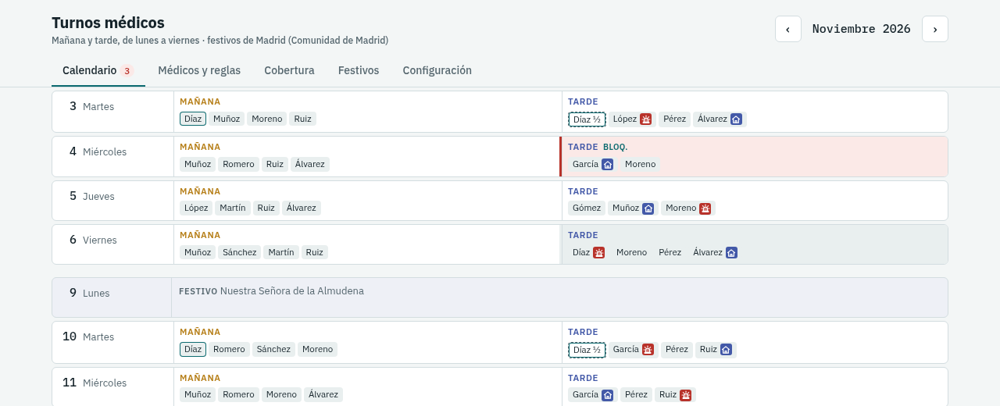
4. Si quieres, retoca el calendario a mano (siguiente apartado).
5. Pulsa **Publicar**. El mes queda cerrado en solo lectura y pasa a contar
   para equilibrar la carga de los meses siguientes.

Otros botones:

- **Regenerar**: vuelve a calcular el mes respetando lo que hayas cambiado a
  mano y cambiando lo mínimo posible.
- **Generar alternativa**: busca otro reparto igual de válido, con algunos
  turnos distintos.
- **Reabrir**: vuelve a permitir cambios en un mes publicado.

### Si no hay un calendario válido

Si las reglas no se pueden cumplir todas (por ejemplo, hay demasiadas
ausencias un día), la aplicación genera igualmente el mejor calendario
posible, marca en rojo los turnos sin cubrir y explica la causa en **Problemas
a resolver**. Por ejemplo:

> El martes 11/11 por la mañana falta 1 médico.
> Causa: El martes 11/11 por la mañana se necesitan 4 médicos pero solo hay
> 3 disponibles.

Para resolverlo puedes cambiar la cobertura de ese día (excepción por fecha),
ajustar las reglas o las ausencias, o cubrir el hueco a mano.

## 6. Retocar el calendario a mano

### Urgencias y domicilios

Cada tarde, entre los médicos asignados, uno hace **urgencias** en el centro
(icono rojo de una luz de emergencia, como la de una ambulancia) y otro
**domicilios** (icono azul de una casa). Al pasar el ratón por el icono se ve
su nombre. Nunca es el
mismo médico, y solo puede serlo quien hace la tarde completa. El generador
los reparte entre todos los médicos que tienen tardes disponibles, en
proporción a su **presencia** en el mes: quien tiene ausencias recibe menos
(por ejemplo, la mitad si falta medio mes). Entre médicos con la misma
presencia no hay más de una de diferencia en cada papel, ni en los dos
juntos. Si prefieres repartirlos por igual aunque haya ausencias, desactiva la
opción en *Configuración → Reglas generales*.

- Para cambiarlo, abre la tarde (pulsando el turno): cada médico con la tarde
  completa tiene los botones **Urg.** y **Dom.**, con los mismos iconos. Si
  eliges urgencias para quien hacía domicilios, los dos se intercambian el
  papel. El cambio queda
  bloqueado; **Volver a automático** lo devuelve al generador.
- La tabla **Carga por médico** muestra cuántas urgencias (*Urg.*) y
  domicilios (*Dom.*) lleva cada uno en el mes.
- Se exigen las tardes que necesitan al menos 2 médicos (pestaña
  *Cobertura*). Si una tarde no tiene quien haga un papel, aparece en
  *Problemas a resolver*.
- En la hoja de cálculo y en la versión impresa, cada tarde indica quién hace
  urgencias y quién domicilios.

### Panel de un turno

Pulsa un turno (por ejemplo, la tarde del jueves 5) para abrir su panel a la
derecha. Aparecen todos los médicos, primero los que ya lo hacen, con notas
como «Ausente», «No disponible», «trabaja la mañana» y cuántos turnos lleva
cada uno frente a su rango.

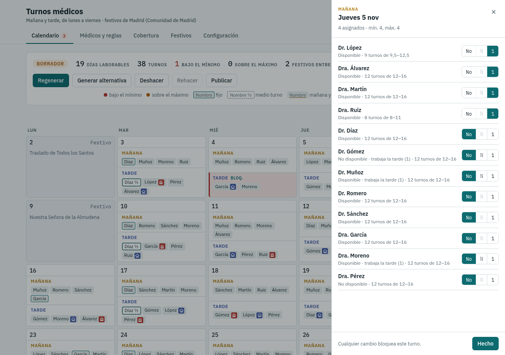

Para cada médico elige:

- **No**: no hace ese turno.
- **½**: medio turno. Solo se puede si ese día hace completo el otro turno
  (es la jornada de turno y medio).
- **1**: el turno completo.

Si eliges a alguien ausente o no disponible, la fila lo indica con «incumple
una regla» (tú tienes la última palabra). Cierra con **Hecho**, con **Esc** o
pulsando fuera del panel.

### Arrastrar y soltar

| Quiero… | Cómo |
|---|---|
| Mover a un médico a otro turno | Arrastra su nombre de un turno a otro. |
| Copiar a un médico (dejarlo en los dos sitios) | Mantén **Ctrl** pulsado mientras lo sueltas. |
| Añadir a un médico a un turno | Arrástralo desde la tabla **Carga por médico** al turno. |
| Quitar a un médico de un turno | Arrástralo fuera del calendario y suéltalo (por ejemplo, sobre la cabecera). |

Mientras arrastras, los turnos te orientan: un borde discontinuo indica que el
médico puede ir ahí, uno **rayado** que está ausente o no disponible, y uno
atenuado que ya está en ese turno.

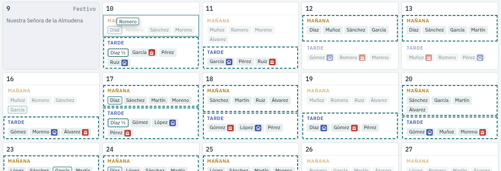

### Bloqueos

- Todo lo que cambias a mano queda **bloqueado** (aparece **BLOQ.** en el
  turno): al regenerar se respeta.
- Si quitas a un médico de un turno, el generador **no lo volverá a poner**
  ahí al regenerar.
- **Volver a automático**, en el panel de un turno, devuelve ese turno al
  generador: quita el bloqueo y deja que lo decida de nuevo al regenerar.
  **Volver a automático todo el mes**, abajo del todo, hace lo mismo con
  todos los turnos del mes.

### Deshacer y ajustar el rango

- **Deshacer** y **Rehacer** (o **Ctrl+Z** y **Ctrl+Y**) funcionan con
  cualquier cambio, también con *Regenerar* y *Volver a automático*.
- En **Carga por médico**, **Ajustar** cambia el rango de un médico solo para
  ese mes (por ejemplo, si va a hacer menos turnos por un motivo puntual).
  **Volver al calculado** deshace el ajuste. Un rango ajustado lleva el
  símbolo ✎.

## 7. Compartir el calendario

Con el mes generado (mejor si ya está publicado), el panel **Exportar** del
final del calendario ofrece:

- **Exportar XLSX**: descarga una hoja de cálculo con tres pestañas:
  - *Calendario*: cada día con los médicos de mañana y de tarde.
  - *Por médico*: una fila por médico con sus turnos (M = mañana,
    T = tarde, ½ = medio turno), para que cada uno vea los suyos.
  - *Resumen*: turnos de cada médico frente a su rango.
- **Imprimir / PDF**: abre una versión para imprimir en A4 horizontal y el
  diálogo de impresión. Para obtener un PDF, elige **Imprimir a archivo**
  (aplicación de escritorio) o **Guardar como PDF** (navegador) como
  impresora.

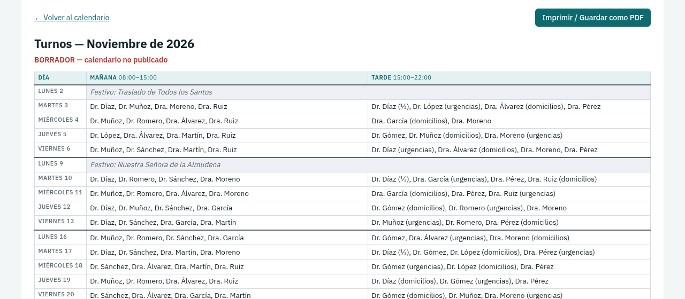

- **Urgencias y domicilios XLSX** e **Imprimir urgencias y domicilios**:
  informe aparte con quién hace urgencias y quién domicilios cada día del mes
  (los festivos y las tardes sin servicio se indican) y, debajo, cuántas
  veces le toca cada papel a cada médico. Se imprime en una hoja A4 vertical;
  es útil para colgarlo o enviarlo al equipo.

Si el mes no está publicado, tanto las hojas como las versiones impresas
indican claramente que es un **BORRADOR**.

## 8. Copias de seguridad

Todos los datos están en un único fichero en tu ordenador
(`~/.local/share/turnosMedicos/turnos.sqlite`, en tu carpeta personal). Haz
una copia de vez en cuando:

1. Ve a **Configuración → Datos: exportar e importar**.
2. Pulsa **Exportar copia de los datos**.
3. Guarda el fichero en otro sitio (un disco externo, la nube…).

La aplicación también hace una copia automática antes de cada actualización.

**Recuperar una copia o llevar los datos a otro ordenador o usuario.** En el
mismo sitio, pulsa **Importar una copia…** y elige el fichero exportado.
Importar **sustituye todos los datos** (médicos, reglas, ausencias, cobertura,
festivos y calendarios) por los de la copia, así que la aplicación lo pregunta
antes. Los datos que había se guardan en una copia junto al fichero de datos
(su ruta aparece al terminar), por si hiciera falta volver atrás. Se aceptan
copias de versiones anteriores de la aplicación; las de una versión más
reciente, no.

## 9. Preguntas frecuentes

**He cambiado las reglas de un médico y el calendario no ha cambiado.**
Las reglas se aplican al **generar**. Pulsa *Regenerar* en el mes afectado.
Comprueba también que las cambiaste con el mes correcto elegido en la
cabecera: valen desde ese mes en adelante.

**Un médico no aparece en el calendario.**
Revisa que esté **activo** y que tenga **carga mensual** para ese mes; si no,
aparece en *Problemas a resolver* y como «sin carga» en *Carga por médico*.

**¿Por qué un médico tiene un rango distinto al de su tarjeta?**
Porque tiene ausencias ese mes: la carga se reduce en proporción. Si aparece
el símbolo ✎, el rango se ajustó a mano para ese mes.

**Aparece «Sesión no válida».**
La pestaña del navegador es de una vez anterior en que se abrió la
aplicación. Ciérrala y vuelve a abrir la aplicación desde su icono o con
`.venv/bin/turnos`.

**¿Cómo saco un PDF?**
Pulsa *Imprimir / PDF* en el calendario y, en el diálogo de impresión, elige
*Imprimir a archivo* (en la aplicación de escritorio) o *Guardar como PDF* (en
el navegador).

**He publicado por error.**
Pulsa **Reabrir**. Los cambios vuelven a estar permitidos.

**¿Puedo generar un mes con varios meses de antelación?**
Sí. Ten en cuenta que, para equilibrar la carga entre meses, solo cuentan los
meses ya **publicados**.

**He pulsado «Generar calendario» y no aparece nada.**
Mira el aviso junto al botón: lo más habitual es que los médicos no tengan
**carga mensual** (turnos/mes mínimo y máximo); sin ella no reciben turnos.

**Quiero indicar el turno de cada médico cada día, pero que no trabajen todos
los días.**
Márcalo como **Hab.** (habitual), no como **Fijo**. El generador decide qué
días trabaja cada uno según la cobertura y su carga, y esos días le da su
turno habitual.

**Un médico no tiene turno algún día y no está ausente.**
Con la opción *Todos los médicos trabajan cada día laborable* activada, el
calendario lo avisa en *Problemas a resolver*; pulsa **Regenerar**. Si lo
quitaste a mano de su turno, el generador no lo devuelve a ese turno, pero sí
puede ponerlo en el otro.

**Un médico hace turno y medio solo algún día suelto, no todas las semanas.**
No lo pongas en sus reglas: hazlo en el calendario, abriendo ese turno y
eligiendo **½** (con el otro turno del día en **1**).
