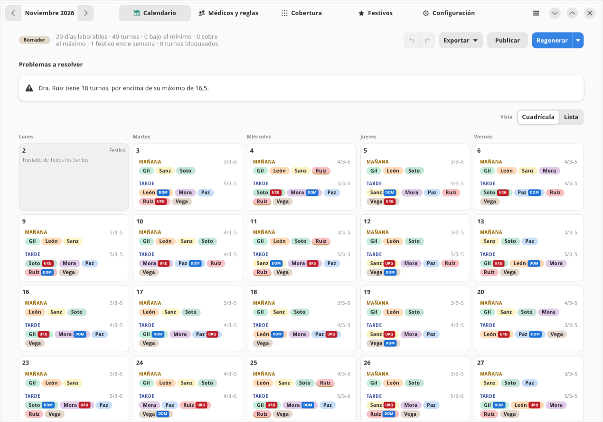
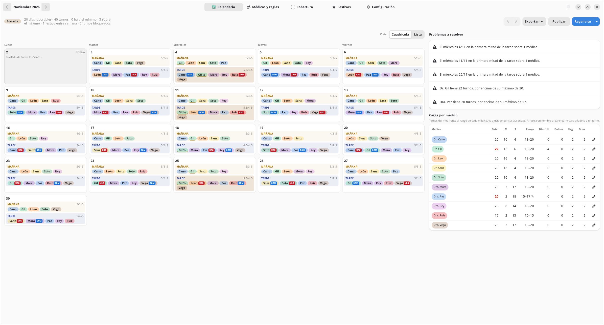
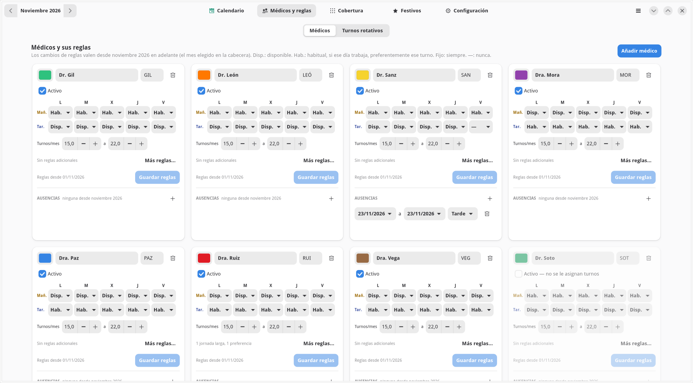
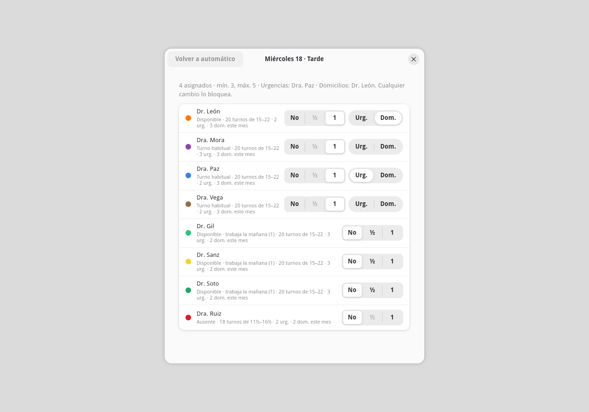
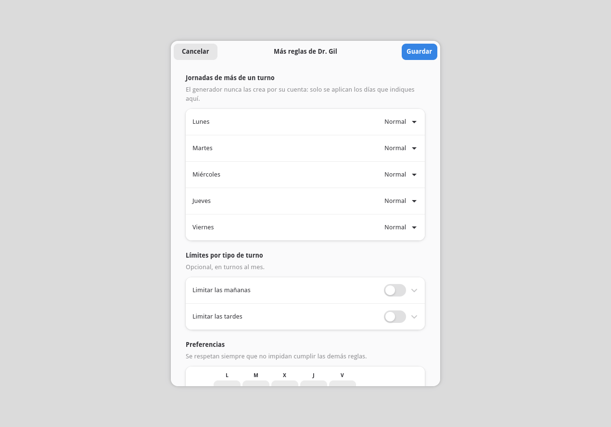
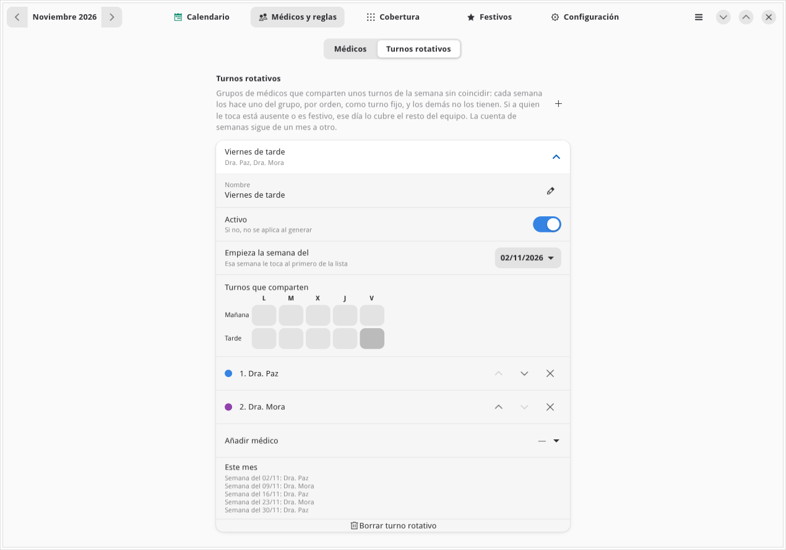
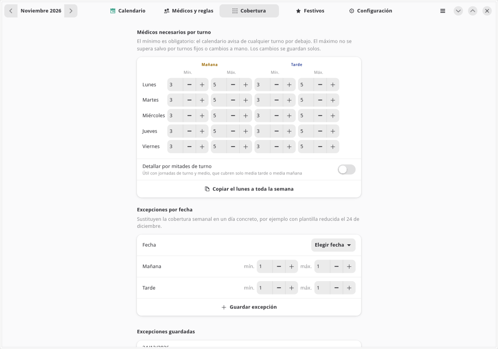
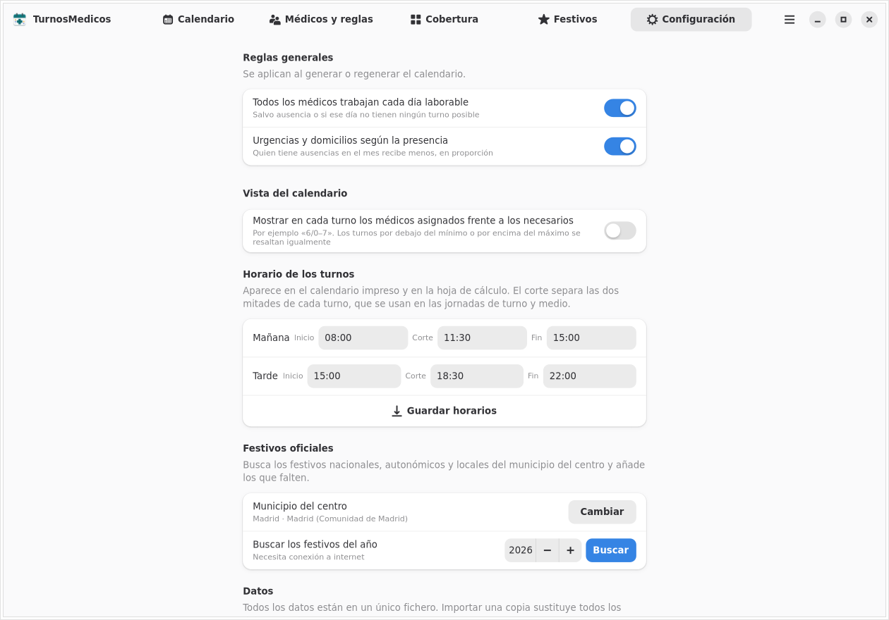
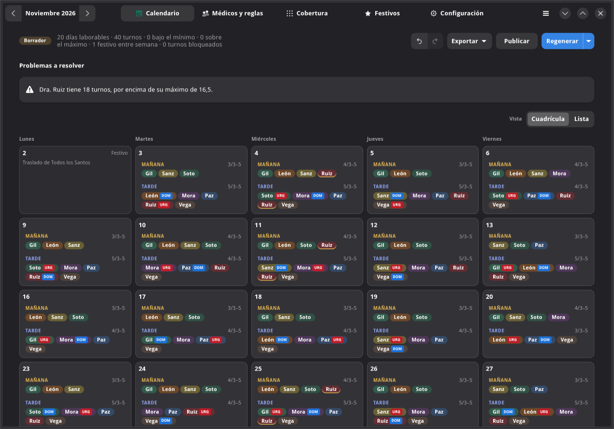
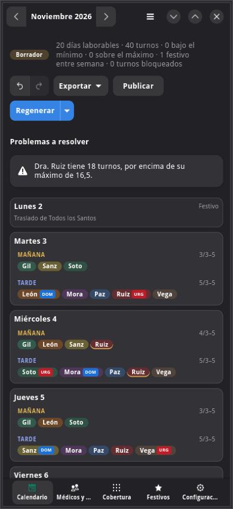

# turnosMedicos — Interfaz nativa GNOME

| | |
|---|---|
| Estado | Completa (v2.11): todas las funciones de la interfaz web. **Alternativa** a la interfaz web; no la sustituye |
| Fecha | 2026-10-17 |
| Relacionado | [diseno-escritorio.md](diseno-escritorio.md), [documentacion-tecnica.md](documentacion-tecnica.md) |

## 1. Objetivo

Turnos médicos como aplicación GNOME de verdad, con los widgets de GTK 4 y
libadwaita (listas, interruptores, diálogos, cabecera con pestañas), en lugar de
la interfaz web dentro de una ventana, para que los usuarios comparen y elijan.

Empezó como prototipo (v2.10, solo lo del día a día) y en la v2.11 se completó
con el resto de funciones. Las dos interfaces conviven y usan los mismos datos.

## 2. Cómo abrirla

- **Desde el menú de aplicaciones**: «Turnos médicos (nativa)», junto a «Turnos
  médicos». Las dos vienen en el mismo paquete Flatpak y usan **los mismos
  datos**; se pueden abrir a la vez.
- **Sin Flatpak** (desarrollo): `.venv/bin/turnos-gnome`.

## 3. Qué incluye

| Pantalla | Funciones |
|---|---|
| Cabecera | Icono y nombre de la aplicación, pestañas (abajo en ventanas estrechas), menú con *Recargar* (Ctrl+R) y *Acerca de*. El mes de trabajo (‹ ›, Alt+← / Alt+→) está junto a los botones de cada pantalla que lo usa (calendario, médicos y festivos) y es común a todas |
| Calendario | Cuadrícula o lista de días (en ventanas estrechas, siempre lista); mañana y tarde con fondos ligeramente distintos; en monitores anchos (desde unos 1.700 px), problemas y carga por médico en una columna al lado; médicos de cada turno con su color, ½, mañana y tarde, urgencias (icono de luz de emergencia) y domicilios (icono de casa), como en la web, y candado si se cambió a mano; turnos bajo el mínimo o sobre el máximo resaltados; cifras del mes; *Generar / Regenerar* y, en su menú, *Generar alternativa* y *Volver a automático todo el mes*; **deshacer y rehacer** (Ctrl+Z, Ctrl+Y); *Publicar / Reabrir*; *Problemas a resolver* (cobertura sin definir, médicos sin carga, festivos por publicar, reglas incumplidas con su causa); **tabla de carga por médico** como la de la web (total, mañanas, tardes, rango, días de turno y medio, dobles, urgencias y domicilios) con **ajuste del rango del mes**; *Exportar* a hoja de cálculo e **imprimir o guardar en PDF** el calendario y las urgencias y domicilios |
| Arrastrar y soltar | Arrastra un médico de un turno a otro para moverlo (con **Ctrl**, para copiarlo), desde la tabla de carga para añadirlo, o fuera de cualquier turno para quitarlo. Las mismas reglas que en la web |
| Diálogo de un turno | Para cada médico, **No / ½ / 1** y, por la tarde, **Urg. / Dom.**; notas (ausente, no disponible, turno habitual, otro turno ese día, carga, urgencias y domicilios del mes); *Volver a automático* |
| Médicos y reglas | Subpestañas *Médicos* y *Turnos rotativos*. Como en la web, una **tarjeta abierta por médico**, en paralelo (tantas columnas como quepan: hasta 8 en monitores muy anchos): color, nombre, código, activo, cuadrícula semanal (Disp. / Hab. / Fijo / —), carga mensual, **Más reglas** (jornadas de más de un turno, límites por tipo de turno, preferencias) y **ausencias**; añadir y borrar médicos |
| Turnos rotativos | Nombre, activo, semana de inicio, médicos por orden (subir, bajar, quitar, añadir), turnos que comparten y a quién le toca cada semana del mes; se guardan solos |
| Cobertura | Médicos necesarios por día y turno (o por mitades), *Copiar el lunes a toda la semana*, guardado automático; excepciones por fecha |
| Festivos | Festivos del año; añadir y quitar; aviso si faltan por publicar; *Restaurar los precargados* |
| Configuración | Reglas generales, vista del calendario (asignados frente a necesarios en cada turno), horario de los turnos, municipio del centro con buscador, festivos oficiales (con enlaces a la fuente), exportar e importar los datos |



En un monitor ancho, problemas y carga por médico van al lado:





| Diálogo de un turno |
|---|
|  |

| Más reglas | Turnos rotativos |
|---|---|
|  |  |

| Cobertura | Configuración |
|---|---|
|  |  |

| Tema oscuro | Ventana estrecha (tema oscuro) |
|---|---|
|  |  |

## 4. Diferencias que quedan con la interfaz web

| Tema | Web | Nativa |
|---|---|---|
| Reglas de un médico | Se guardan solas al editarlas | Botón *Guardar reglas* (los datos del médico, las ausencias, los turnos rotativos y la cobertura sí se guardan solos) |
| Arrastrar con el teclado | Sí | No: con el teclado, el diálogo del turno |
| Vista cuadrícula / lista | Se recuerda | Se elige en cada sesión |
| Enlaces en los avisos | Llevan a la pestaña | Indican la pestaña |
| Impresión | La del navegador | Diálogo de impresión de GTK (*Imprimir a archivo* para PDF) |

## 5. Arquitectura

```
Ventana GTK / libadwaita ──JSON (127.0.0.1, token)──▶ FastAPI ── servicios ── motor
          (turnos.arranque.gnome)                     (el mismo servidor que la web)
```

- La interfaz nativa es **cliente de la misma API** que la web: no duplica reglas
  ni validaciones, y todo lo que ya está probado en las pruebas del núcleo y de la
  API le vale igual. El servidor arranca en un hilo, como en el modo escritorio.
- Las peticiones van en un hilo y la respuesta vuelve al de la interfaz
  (`ClienteApi.en_segundo_plano`), así la ventana no se congela al generar.
- Cada pantalla se recarga al mostrarla si algo ha cambiado desde la última vez.
- Código (unas 2.700 líneas): `src/turnos/arranque/gnome/` — `aplicacion`,
  `ventana`, `cliente`, `comun` (textos y widgets: selector de fecha, número,
  guardado diferido), `calendario` (incluye la lógica de soltar, igual que la
  web), `imprimir` (informes con Cairo y Pango), `medicos`, `rotaciones`,
  `cobertura`, `festivos`, `configuracion`, `estilos.css`. Identificador propio,
  `io.oriol.TurnosMedicos.Nativa`, para que pueda abrirse a la vez que la otra.
- Pruebas automáticas (`tests/escritorio/test_gnome.py`, con Xvfb): abren la
  ventana y, desde los widgets, generan y piden una alternativa, deshacen y
  rehacen, arrastran, ajustan un rango, imprimen los dos informes a PDF, quitan
  a un médico de un turno y cambian un papel, guardan reglas, una ausencia y
  «Más reglas», crean un turno rotativo, cambian la cobertura y una excepción,
  el horario y los festivos; luego comprueban el resultado en la API. Además,
  la lógica de soltar se prueba con los mismos casos que la web.

## 6. Comparación

| | Interfaz web (también en la ventana de escritorio) | Interfaz nativa |
|---|---|---|
| Aspecto | Propio, igual en navegador y escritorio | El de GNOME: sigue el tema claro u oscuro, los tamaños de letra y la accesibilidad del sistema |
| Uso con teclado y lector de pantalla | Bueno | Muy bueno (widgets estándar) |
| Ventanas estrechas | Sí | Sí (pestañas abajo, lista de días) |
| Funciones | Todas | Todas (sección 4: pequeñas diferencias) |
| Navegador / otros sistemas | Sí, cualquier navegador | Solo escritorio Linux con GTK |
| Mantenimiento | Una interfaz | Dos interfaces mientras convivan |

## 7. Recomendación

Que los usuarios usen las dos durante unos días con datos reales y elijan.
Mantener las dos a largo plazo duplica cada cambio de la interfaz: lo razonable
es quedarse con una (o con la web solo para el modo navegador).
